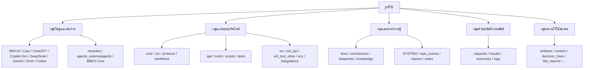

# แผนที่โฟลเดอร์ของรีโป W3_HB_team_BXCGICOG (ฉบับภาษาไทย)

> จัดทำจากชื่อโฟลเดอร์ README และไฟล์ที่อยู่ข้างใน ณ ตอนที่ย้ายเอกสารออกจากรูท
> รายการที่ระบุว่า **(เดา)** คือคาดจากชื่อและเนื้อหา ยังไม่มีเอกสารยืนยันเจตนา
> รายการ **(สงวนไว้)** คือโฟลเดอร์ที่มีแค่ `.gitkeep` ตั้งไว้สำหรับอนาคต

## ภาพรวม

## 1) กลุ่มโมดูลเอเจนท์ AI (ผู้ใช้งาน/ผู้ทำงานแต่ละตัว)

| โฟลเดอร์ | คืออะไร |
|---|---|
| `BBX19/` | โมดูล BBX19 (README ระบุว่าเป็น "null Module") มี directives และ status |
| `Cast/` | โมดูล Cast — ผู้แปล/ผู้สร้างสถาปัตยกรรมเอกสาร (Interpreter & Document Architect) |
| `ChatGPT/` | พื้นที่ทำงานและบันทึกของเอเจนท์ ChatGPT |
| `Copilot-Gm/` | พื้นที่ทำงานของเอเจนท์ Copilot-Gm |
| `DeepSeek/` | พื้นที่ทำงานของเอเจนท์ DeepSeek |
| `Gemini/` | โมดูล Gemini — วิเคราะห์เชิงลึกและตรวจสอบ (Deep Analysis & Validation) |
| `Grok/` | พื้นที่ทำงานของเอเจนท์ Grok |
| `codex/` | Codex — เอเจนท์ผู้ลงมือทำในรีโป (Implementation Agent / Repo Executor) |
| `modules/` | ที่รวมโมดูลทั้งหมดแบบมาตรฐาน มี `registry.json` และ `module.json` ของแต่ละโมดูล (รวม LRC2, PSP2, DTML) |
| `agents_externalagents/` | โค้ดสำหรับเอเจนท์ภายนอก (เช่น `task_agent.py`) **(เดา)** |
| `BBEX-Core/` | แกนของ BBEX: โปรโตคอล Hybrid, ส่วน `private/` และ `public/` |
| `HBISOCITY/` | พื้นที่ HBISOCITY (README ระบุเป็นเมือง/แนวคิดของระบบ) |
| `Hybrid-Management-Model/` | หลักการทีมและสถานะระบบแบบ Hybrid (`team-doctrine.md`) |

## 2) กลุ่มแกนระบบ / รันไทม์ (โค้ดที่ทำให้ระบบทำงาน)

| โฟลเดอร์ | คืออะไร |
|---|---|
| `core/` | แกนกลางของระบบ: identity (โปรไฟล์ IDP), governance, memory, events, adapters, modules_loader |
| `src/` | ซอร์สโค้ดหลัก (core, modules, utils, w3db, main.py) |
| `protocol/` | โปรโตคอลของระบบ: EP_SIGNAL, MPCP, w3db, w3lgu, ECS |
| `workflows/` | ระบบจัดลำดับงาน (orchestration) และ schema ของงาน |
| `iget/` | IGET — ตัวรันกำกับดูแล PR แบบ semantic (มีชุดทดสอบของตัวเอง) |
| `tools/` | เครื่องมือบรรทัดคำสั่ง เช่น `request_cycle.py` |
| `scripts/` | สคริปต์ตรวจกฎ เช่น บังคับการแยกชั้น (layer separation) |
| `tests/` | ชุดทดสอบของรีโป |
| `wx/` | โครงสร้างความรู้ BOX / Library-WX |
| `w3_api/` | W3-API — เกตเวย์ Cross Gateway |
| `w3_tool_store/` | คลังเครื่องมือ/แม่แบบ (compiled, hybrid_syncap, sheets) |
| `ecs/` | ระบบห่วงโซ่เหตุการณ์ (Event Chain System) |
| `integrations/` | ตัวเชื่อมกับระบบภายนอก เช่น `ep_signal_w3db.py` |
| `config/` | ค่าตั้งต้นสภาพแวดล้อม W3 |
| `meta/` | metadata และสัญญาข้อมูล (data-contracts) |
| `versions/` | บันทึกเวอร์ชัน (ตอนนี้มี v0.1) |
| `croll/` | CROLL / Cross-L — ส่วนที่เกี่ยวกับ Cross-layer |
| `cross_x/` | Cross-X — แนวคิดการเชื่อมข้ามระบบ |

## 3) กลุ่มเอกสาร / ความรู้ (อ่านทำความเข้าใจ)

| โฟลเดอร์ | คืออะไร |
|---|---|
| `docs/` | เอกสารหลักของ W3: คู่มือ เริ่มต้นใช้งาน มาตรฐาน ปรัชญา รายงาน |
| `architecture/` | แผนภาพและเอกสารสถาปัตยกรรม (layers, system-map, interface-map) |
| `blueprints/` | พิมพ์เขียวระบบ (abstract, security, GGinventory) |
| `knowledge/` | คลังความรู้และปรัชญา |
| `hospitication/` | Hospitication — เอกสารและรายงานแนวคิดต้อนรับ/ตรวจโครงสร้าง **(เดา)** |
| `branding/` | โลโก้และเอกสารแบรนด์ |
| `examples/` | ตัวอย่างการใช้งาน |
| `codex/`, `notes/` | บันทึกและโน้ตของเอเจนท์/ทีม |
| `full_moon_analysis/` | เอกสารวิเคราะห์เชิงปรัชญาชุด "ข้อความเต็มดวง" **(เดา)** |
| `SYSTEM/` | รายการระบบ W3HBT-LIST, ชุดทดสอบ และ `w3_infomation/` (โฟลเดอร์นี้) |
| `repo_events/` | รายงาน หนังสือ และบันทึกเหตุการณ์ของรีโปแบบอ่านเป็นรายการ |
| `reports/` | รายงานตรวจโครงสร้าง แผนจัดระเบียบ ความสมบูรณ์ของโมดูล |

## 4) กลุ่มคำขอ / บันทึก / ผลลัพธ์ (ร่องรอยการทำงาน)

| โฟลเดอร์ | คืออะไร |
|---|---|
| `requests/` | คำขอ (RQ-...) ที่ส่งเข้าระบบ พร้อมเอกสาร REVIEW |
| `results/` | ผลลัพธ์ของคำขอ เช่น structural_blueprints |
| `outcomes/` | สมุดบันทึกผลลัพธ์ (Outcomes Ledger) |
| `logs/` | บันทึกการทำงาน: daily, engine, interaction_history, check-in, request_cycle |

## 5) โฟลเดอร์สงวนไว้ใช้อนาคต (มีแค่ `.gitkeep`)

| โฟลเดอร์ | ความหมายที่คาด (เดา) |
|---|---|
| `artifacts/` | ที่เก็บชิ้นงานผลลัพธ์ |
| `context/` | ที่เก็บบริบทของงาน/เซสชัน |
| `decision_trace/` | ร่องรอยการตัดสินใจ |
| `connection_maps/` | แผนผังการเชื่อมต่อ |
| `fbd_reports/` | รายงานแบบ FBD |
| `gatekeeping_logs/` | บันทึกการคัดกรองผ่านด่าน |
| `narrative_reports/` | รายงานเชิงเล่าเรื่อง |
| `system_observations/` | บันทึกการสังเกตระบบ |
| `tuf_snapshots/` | snapshot สำหรับ TUF |

> ยังไม่แตะโฟลเดอร์เหล่านี้ตามที่ตกลง จะใช้กติกา BOX/AMS จัดวางเมื่ออัปเดตรีโปเสร็จ

## หมายเหตุ

- `W3_HB_team_BXCGICOG` ที่รูทเป็น symlink ชี้ไปพาธใน Termux ใช้งานไม่ได้นอกเครื่องผู้ใช้
- `README.md` ที่รูทอยู่ที่เดิม
